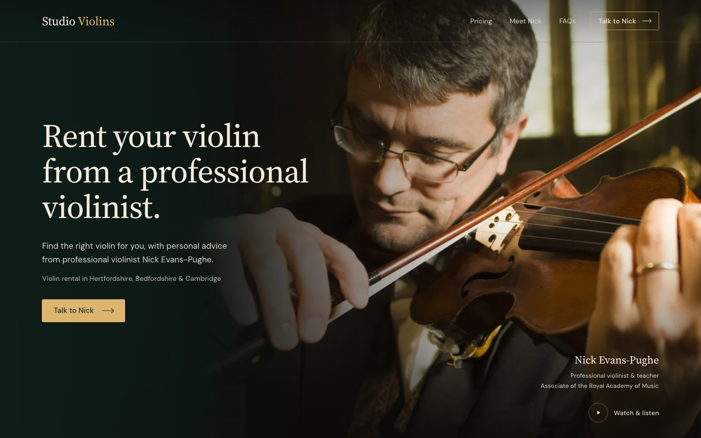
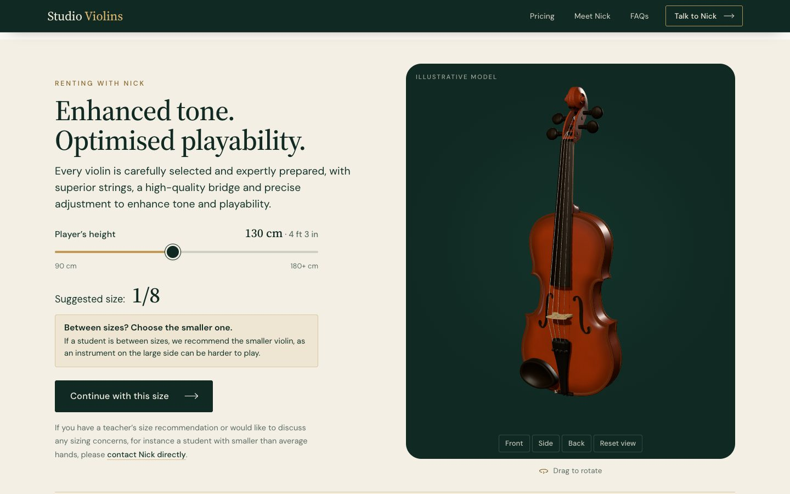
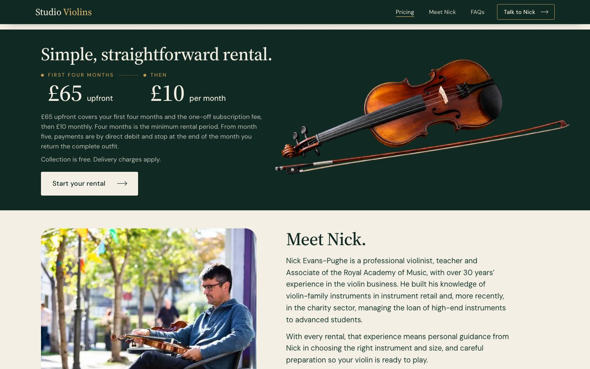

# Studio Violins

Website for [Studio Violins](https://www.studioviolins.co.uk), a violin rental service based in Hitchin, run by the professional violinist Nick Evans-Pughe. It helps families and players choose the right size, see what renting involves and get in touch with Nick.

**Website:** https://www.studioviolins.co.uk



## Features

- **Hero with video.** A photograph of Nick, a short preview video, and a "Watch & listen" performance video.
- **Interactive 3D violin.** A three.js viewer for a Draco-compressed glTF model, with front, side and back views and drag to rotate. It loads only as the section approaches, and falls back to a still image.
- **Height-to-size guide.** A slider suggests a starting violin size from the player's height and carries it into the enquiry form.
- **Pricing, Meet Nick and FAQs.** The FAQ answers link to the matching section of the rental terms.
- **Contact options.** WhatsApp, email, or a message form sent by a server action over SMTP (Nodemailer). If email isn't configured, the form says so and offers WhatsApp or email instead. It never reports success unless the message was accepted for delivery.
- **Supporting pages.** Rental terms, privacy policy, a custom 404 page, sitemap, robots.txt, web manifest and icons, an Open Graph sharing image, `LocalBusiness` structured data, and a permanent redirect from the old `/contact` address.
- **Lightweight.** No cookies, browser storage or analytics. Every page is prerendered as static HTML.

## Screenshots

| Renting with Nick: 3D violin and size guide | Pricing |
|---|---|
|  |  |


## Tech stack

- [Next.js](https://nextjs.org) 16 (App Router, Turbopack), React 19 and TypeScript
- CSS Modules, with Source Serif 4 and DM Sans loaded through `next/font`
- [three.js](https://threejs.org) and the Draco decoder, vendored in `public/violin-3d/vendor/`
- [Embla Carousel](https://www.embla-carousel.com) for the reviews
- [Nodemailer](https://nodemailer.com) for the contact form

## Getting started

You need Node.js 20.9 or later.

```bash
npm ci
npm run dev
```

The site runs at http://localhost:3000. For a production build:

```bash
npm run build
npm start
```

## Environment variables

Only the contact form needs configuration. Copy `.env.example` to `.env.local` for local use. On the host (for example, Vercel → Project Settings → Environment Variables), set the same names there. Never commit real values.

| Variable | Required | Purpose |
|---|---|---|
| `CONTACT_SMTP_HOST` | Yes | Outgoing (SMTP) server for the mailbox that sends enquiries |
| `CONTACT_SMTP_PORT` | No | `465` (implicit TLS, the default) or `587` (STARTTLS) |
| `CONTACT_SMTP_USER` | Yes | SMTP username |
| `CONTACT_SMTP_PASS` | Yes | SMTP password |
| `CONTACT_TO` | No | Where enquiries are delivered. Defaults to the business address |
| `CONTACT_FROM` | No | Sender address. Defaults to the business address, and must be one the SMTP account may send from |
| `CONTACT_DEV_OUTBOX` | No | Development only: `1` writes messages to `output/dev-outbox/*.eml` instead of sending them |

Without the required values the site still builds and runs. The form then shows a "couldn't be sent" message with the WhatsApp and email alternatives.

## Project structure

```
app/            Routes (home, terms, privacy, 404), metadata, icons, sitemap and robots
components/     One folder per section; copy lives in each folder's content.ts, apart from the markup
assets/         Images imported by components, and the brand monogram source
public/         Videos, the 3D viewer and model, and vendored three.js and Draco files
scripts/        Asset-preparation scripts (their source media aren't in this repository)
```

## Credits and licence

three.js is MIT licensed; its licence is in `public/violin-3d/vendor/three/LICENSE`. The Draco decoder is © Google, under the Apache License 2.0. The 3D violin is an illustrative model, not a photograph of a rental instrument.

This repository is shared as a portfolio piece. No licence is granted for the photographs, videos, written content or brand assets.
